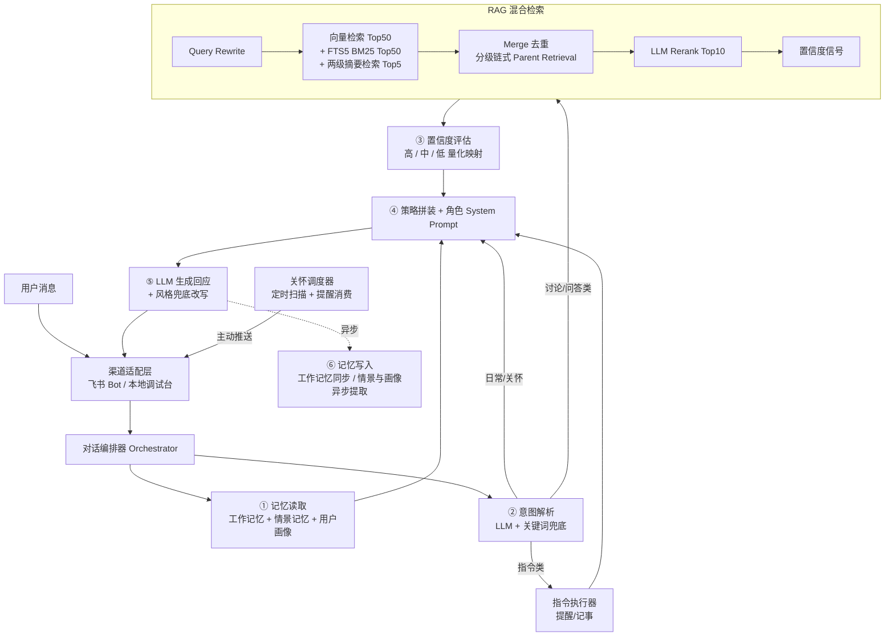

# HachiYang · 秧秧·玄翎 陪伴型 Agent


> "如果你是那阵漂泊无定的风，那么，我想做一只随风飘游的鸟儿。"

HachiYang 是一个以游戏《鸣潮》角色 **秧秧·玄翎** 为人格基底的**长期陪伴型 AI Agent**。她不是去人格化的通用助手，而是一位温柔坚强、能与你讨论心理学与哲学话题、记得你们之间的故事、并会在深夜提醒你早些休息的"朋友"。

- 💬 **远程对话渠道**：以飞书（Feishu）机器人形式提供服务，支持单聊与群聊 @，多端同步
- 📚 **知识驱动对话**：基于弗洛伊德、荣格及哲学著作的中文 RAG 混合检索，观点有据可查
- 🧠 **三层长期记忆**：工作记忆 / 情景记忆 / 用户画像，跨会话连续、多用户隔离
- 🌙 **主动生活关怀**：起居状态识别 + 定时主动提醒，文案经 LLM 角色化生成，自然不机械
- 🔍 **置信度透明**：回答置信度由检索信号量化映射，不确定时主动使用"可能""或许"

---

## 目录

- [项目背景](#项目背景)
- [核心特性](#核心特性)
- [系统架构](#系统架构)
- [技术栈](#技术栈)
- [快速开始](#快速开始)
- [知识库索引构建](#知识库索引构建)
- [本地调试台](#本地调试台)
- [测试](#测试)
- [目录结构](#目录结构)
- [配置项参考](#配置项参考)
- [声明与免责](#声明与免责)

---

## 项目背景

在心理与精神生活日益受到重视的当下，通用助手"工具化、去人格化"的回答难以满足"像熟悉的朋友一样交流心理学/哲学观点、且角色始终一致"的诉求。

本项目以秧秧·玄翎的人设为载体——明庭音乐世家二小姐、祀声之人、剑士，温柔坚强、纯粹浪漫、仗剑行义，对"漂泊者"（用户）有着誓言般的相伴承诺。日常场景中，她称用户为"漂泊者"，在亲昵与关怀场景则会唤你一声**用户自定义昵称**。

**适用场景**：日常寒暄与情绪倾诉、心理学/哲学观点讨论与切磋、知识问答、提醒与记事、起居健康关怀。

**非目标**：不做脱离人设的通用助手；不提供临床心理诊断或治疗（必要时会建议寻求专业帮助）；本期不包含 TTS 与实时语音（已预留扩展接口）。

---

## 核心特性

### 🎭 角色人格一致性

- 人格唯一来源为结构化的 [yangyang_xuanling_soul.json](character/yangyang_xuanling_soul.json)，涵盖性格特质、核心信念、说话风格、背景经历等
- 严格保持称呼（漂泊者 / 用户自定义昵称）、标志性措辞（"……""且听风吟""我能感知到"）与语气统计特征
- **场景风格自适应**：日常温柔含蓄、学术解释如学者般严谨、面对悲伤事物会共情道歉、情感表达诗意而深沉
- 对话语料库（189 个分类片段）提供场景化语言参考

### 📚 RAG 知识检索

- **全中文知识库**：弗洛伊德文集（全十二册）、荣格文集典藏版、中国哲学通史（1–5 卷）、罗素《哲学简史》、《大问题：简明哲学导论》
- **三阶段索引流水线**：提取落盘 → 切片落盘 → Embedding 入库，每一阶段产物人工可读、可检查，问题拦截在入库之前
- **层级优先分块**：尊重"书 → 卷 → 章 → 节 → 段落"天然边界，不做固定长度硬切；每条切片携带 6 级溯源元数据
- **混合检索管线**：
  - Query Rewrite（LLM 处理指代、省略与模糊表述）
  - 段落级向量检索（Top-50）+ SQLite FTS5 关键词检索（BM25，Top-50）
  - **两级章节摘要检索**：章摘要（<400 字）+ 节摘要（<200 字），泛话题不再"盲人摸象"
  - Merge 去重 → **分级链式 Parent Retrieval** → LLM Rerank 精排 Top-10
- **分级链式展开**：章摘要命中只召回该章的节摘要；节摘要命中才召回正文段落；章摘要展开的节摘要需过相似度二次门槛（默认 0.4），防止候选爆炸
- **结构化置信度信号**：命中数、Rerank 最高分、来源多样性、章节覆盖度、展开深度等，供置信度模块量化分级
- 支持按领域软过滤（Freud / Jung / Philosophy）、增量索引与断点重建
- 视觉多模态（插图向量化）与术语表功能以开关形式保留，默认关闭

### 🧠 三层记忆系统

| 层级 | 内容 | 特点 |
|------|------|------|
| **工作记忆** | 当前会话的近期对话 | 12 轮滑动窗口，超限轮次不再占用 LLM 上下文 |
| **情景记忆** | 跨会话的事件与话题摘要 | Embedding 向量检索，带时间衰减（14 天优先级降低），每周清理低衰减条目 |
| **用户画像** | 稳定事实（作息节律、偏好、chat_id 等） | LLM 提取事实并 merge，支撑关怀调度 |

- 记忆写入**完全异步**，不阻塞对话响应
- 所有记忆以 `chat_id + user_id` 强制隔离，多用户互不泄露
- 敏感对话脱敏存储（仅记录 topic，不留症状细节）
- 支持用户主动遗忘（"忘掉之前关于 X 的对话"）

### 🌙 关怀调度

- 从"早安/晚安"等消息识别起居状态，结合时区（默认 `Asia/Shanghai`）与作息窗口判定
- 在就寝时段（默认 22:30–23:59）与起床时段（默认 06:00–09:00）主动推送关怀
- 文案经 LLM 角色化生成（失败自动降级模板），同模板不连续复用
- 单用户单日主动关怀 ≤ 2 次；已道早晚安当日不再打扰
- 用户自设提醒到期一并投递，不计入关怀上限；飞书未配置时自动进入 dry-run

### 🔀 渠道与意图

- 飞书长连接（WebSocket，本地开发免公网）与 Webhook 回调（生产部署）双模式
- 五类意图识别：日常交流 / 观点讨论 / 知识问答 / 指令执行 / 关怀，LLM 解析 + 关键词兜底
- 指令系统支持提醒登记、事项记录等；模糊指令主动确认，不可执行时以角色口吻说明
- 渠道适配层与核心对话管线解耦，后续接入微信、Slack 等只需新增适配器

---

## 系统架构



模块间通过明确接口协作：新增能力（TTS、ASR、新 IM、新知识库）以插件方式接入，无需改动核心编排。知识检索与记忆检索复用同一 Embedding 模型，但向量 Collection 严格隔离。

---

## 技术栈

| 分类 | 选型 |
|------|------|
| 语言 | Python ≥ 3.11 |
| Web 框架 | FastAPI + Uvicorn |
| 飞书接入 | lark-oapi（事件订阅 / WebSocket 长连接 / 消息 API） |
| LLM | OpenAI 兼容接口 · `deepseek-v4-pro` |
| Embedding | OpenAI 兼容接口 · `doubao-embedding-vision` |
| 向量库 | ChromaDB（持久化） |
| 结构化存储 | SQLite（会话/画像/提醒 + FTS5 全文检索） |
| 文档解析 | EbookLib + BeautifulSoup4（EPUB）、PyMuPDF（PDF） |
| 数据建模 | Pydantic v2 / pydantic-settings |
| 测试 | pytest |

---

## 快速开始

### 1. 环境要求

- Python 3.11 或更高版本
- 一个 **OpenAI 兼容接口的 API Key**：任意支持 OpenAI 兼容协议的模型服务均可，需同时提供 Chat Completions 与 Embedding 能力
- 一个[飞书开放平台](https://open.feishu.cn/)自建应用（仅本地调试台体验可暂不配置）

### 2. 安装依赖

```bash
git clone https://github.com/<your-name>/HachiYang.git
cd HachiYang

python -m venv .venv
# Windows
.venv\Scripts\activate
# macOS / Linux
source .venv/bin/activate

pip install -r requirements.txt
# 测试依赖已包含在 requirements.txt 中；也可：pip install -e ".[test]"
```

### 3. 配置环境变量

复制示例文件并填入**非密钥**配置：

```bash
cp .env.example .env
```

> 🔐 **密钥安全约定**：API Key 禁止写入 `.env` 明文。`ARK_KEY` 只从**系统用户环境变量**读取（加载优先级：系统环境变量 > `.env`）。

Windows（PowerShell，执行一次后重开终端生效）：

```powershell
[Environment]::SetEnvironmentVariable('ARK_KEY','你的 OpenAI 兼容协议APIKey','User')
```

macOS / Linux（写入 `~/.bashrc` 或 `~/.zshrc`）：

```bash
export ARK_KEY="你的 OpenAI 兼容协议APIKey"
```

`.env` 中至少需要配置：

```ini
ARK_BASE_URL=https://ark.cn-beijing.volces.com/api/v3
LLM_MODEL=deepseek-v4-pro
EMBEDDING_MODEL=doubao-embedding-vision

FEISHU_APP_ID=cli_your_app_id
FEISHU_APP_SECRET=your_app_secret
FEISHU_VERIFICATION_TOKEN=your_verification_token
FEISHU_MODE=websocket
```

配置缺失时服务**不会崩溃**，而是在启动日志中输出明确告警，不依赖密钥的调试台与存储功能仍可使用。

> 💡 **关于模型名**：标准 OpenAI 兼容端点（`/api/v3`）下，`LLM_MODEL` / `EMBEDDING_MODEL` 需填写使用的**模型 ID**（如 `doubao-...`）或**推理接入点 ID**（`ep-...`）。上文为默认示例值，请按你的账号实际可用模型替换。

### 4. 准备知识库

将合法获取的 EPUB 文献按领域放入对应目录（书籍受版权保护，不随仓库分发）：

```text
knowledge_base/
├── Freud/      # 弗洛伊德文集（EPUB，支持多卷合订本自动按卷拆分）
├── Jung/       # 荣格文集（EPUB）
└── Philosophy/ # 哲学类著作（EPUB）
```

### 5. 启动服务

```bash
python app/main.py
# 或
python -m app.main
```

服务默认监听 `0.0.0.0:8080`：

- 健康检查：<http://localhost:8080/health>
- 本地调试台：<http://localhost:8080/debug>
- 飞书 Webhook 事件端点（生产模式）：`POST http://<host>:8080/feishu/event`

### 6. 飞书机器人配置要点

1. 在飞书开放平台创建**企业自建应用**，开启"机器人"能力
2. 添加权限：`im:message`、`im:message:send_as_bot`、接收消息事件 `im.message.receive_v1`
3. **开发模式**：`FEISHU_MODE=websocket`，通过长连接接收事件，无需公网地址
4. **生产模式**：`FEISHU_MODE=webhook`，将事件订阅请求地址指向 `https://<你的域名>/feishu/event`，按平台要求填写 Verification Token / Encrypt Key
5. 发布应用后，在单聊中直接发消息、或在群聊中 @ 机器人即可对话

---

## 知识库索引构建

索引采用**三阶段流水线**，前两个阶段完全不消耗 API 配额，建议逐阶段人工检查后再进入下一步：

```bash
# 阶段 1：解析 EPUB，按卷拆分提取，产出 knowledge_extracted/<域>/<卷名>.extracted.md/.json
python scripts/run_pipeline_stages.py --stage extract
# 可加 --only 弗洛伊德 仅处理文件名含关键词的书

# 阶段 2：层级切片，产出 knowledge_chunks/<域>/<卷名>.chunks.json（含 6 级溯源元数据）
python scripts/run_pipeline_stages.py --stage chunk

# 阶段 3：Embedding + 两级章节摘要（章 + 节）写入 ChromaDB / SQLite
python scripts/run_pipeline_stages.py --stage index
# 只处理某一本书：--file knowledge_chunks/freud/卷01-爱情心理学.chunks.json
# 只做 Embedding、暂不生成摘要：--no-summaries
```

卷帙浩繁时，可使用**后台全自动构建脚本**，它支持配额耗尽自动等待、断点续跑与失败轮次重试：

```bash
python scripts/auto_index_all.py                 # 全量（含两级摘要）
python scripts/auto_index_all.py --no-summaries  # 仅 Embedding（不耗 LLM 配额）
```

> 批量构建过程中遇到"请求过频"走短退避；遇到"配额耗尽/余额不足"会等待配额恢复（默认 2 小时）后重试**同一条目**，绝不跳过。在 `.data/` 下创建 `auto_index_stop.flag` 文件可让后台任务在当前书完成后优雅停止。

其他维护脚本：

- `scripts/reindex_all.py`：全量重建索引（支持 `--resume`）
- `scripts/extract_terms.py`：术语表提取（术语功能当前默认关闭，预留使用）

---

## 本地调试台

仅绑定本机、用于开发与自查的 Web 界面（`http://localhost:8080/debug`，非本机访问返回 403）：

- **模拟对话**：复用与飞书完全相同的对话编排器，并提供全链路追踪折叠面板（记忆 → 意图 → 指令 → RAG → 提示词 → LLM → 风格改写的输入输出逐一可查）
- **知识库检查**：文档索引总览、章节 → 切片两级下钻分页（适配单文档 5 万+ 切片）、章节摘要与父子段落互跳核对
- **检索试跑**：FTS 关键词检索（零配额）与向量语义检索（消耗 Embedding 配额），返回 Top-K 候选与分数
- **运行状态**：记忆系统、关怀调度状态一览
- **实时日志流**：SSE 推送，无需盯终端

所有检查端点均为只读 GET，不提供任何编辑/删除操作。

---

## 测试

```bash
# 运行全部测试
pytest

# 按模块运行
pytest tests/test_memory_system.py
pytest tests/test_rag_smoke.py
pytest tests/test_confidence_strategy.py
```

测试覆盖：三层记忆、RAG 流水线各阶段与冒烟、并发提取、配额重试、置信度策略、关怀调度、调试台与 RAG 检查接口等。其中涉及真实 API 的测试（如 `test_rag_real_api.py`）需配置好密钥与配额后运行。

---

## 目录结构

```text
HachiYang/
├── app/                    # 应用主包
│   ├── main.py             # 入口：FastAPI + 组件装配 + lifespan
│   ├── config.py           # 环境变量配置与启动校验
│   ├── core/               # 核心对话链路
│   │   ├── orchestrator.py #   对话编排器（主链路）
│   │   ├── intent.py       #   意图解析
│   │   ├── persona.py      #   角色人格加载
│   │   ├── confidence.py   #   置信度量化映射
│   │   ├── strategy.py     #   对话策略块拼装
│   │   ├── command.py      #   指令执行 / 提醒
│   │   └── models.py       #   Pydantic 统一数据模型
│   ├── llm/                # LLM / Embedding 客户端、提示词、配额重试
│   ├── db/                 # SQLite 连接与 schema
│   ├── channels/           # 渠道适配层
│   │   ├── base.py         #   适配器抽象接口
│   │   └── feishu/         #   飞书适配器 / 客户端 / 事件处理
│   ├── rag/                # RAG 系统
│   │   ├── parsers/        #   EPUB / PDF 解析
│   │   ├── extractor.py    #   阶段1：提取落盘
│   │   ├── chunker.py      #   阶段2：层级切片
│   │   ├── indexer.py      #   阶段3：Embedding + 摘要入库
│   │   ├── retriever.py    #   混合检索管线编排
│   │   ├── reranker.py     #   LLM Rerank 精排
│   │   ├── summarizer.py   #   两级章节摘要
│   │   ├── stores.py       #   ChromaDB / SQLite 存储封装
│   │   ├── term_builder.py / term_lookup.py  # 术语表（预留，默认关闭）
│   ├── memory/             # 三层记忆：working / episodic / profile + manager
│   ├── care/               # 关怀：trigger(起居识别) / composer(文案) / scheduler(调度)
│   └── web/                # 本地调试台：server / rag_inspect / static
├── character/              # 角色人格文件与对话语料
│   ├── yangyang_xuanling_soul.json          # 人格唯一来源
│   ├── yangyang_xuanling_dialogue_corpus.json
│   └── raw/                # 原始人设资料备份
├── knowledge_base/         # 知识库源文件（EPUB，需自行准备，不随仓库分发）
├── knowledge_extracted/    # 阶段1产物（提取稿，人工可读）
├── knowledge_chunks/       # 阶段2产物（切片 JSON）
├── scripts/                # 流水线与维护脚本
├── tests/                  # pytest 测试
├── .env.example            # 环境变量示例
├── pyproject.toml
└── requirements.txt
```

运行时数据（`.data/`，含 SQLite 与 ChromaDB）、`.env`、缓存目录均已在 [.gitignore](.gitignore) 中排除。

---

## 配置项参考

| 环境变量 | 默认值 | 说明 |
|----------|--------|------|
| `ARK_KEY` | — | **必填**。OpenAI 兼容协议 API Key，仅从系统环境变量读取 |
| `ARK_BASE_URL` | — | **必填**。OpenAI 兼容协议 API 地址（LLM/Embedding 共用） |
| `LLM_MODEL` | `deepseek-v4-pro` | 语言模型名 |
| `EMBEDDING_MODEL` | `doubao-embedding-vision` | Embedding 模型名 |
| `FEISHU_APP_ID` | — | 飞书机器人 App ID |
| `FEISHU_APP_SECRET` | — | 飞书机器人 App Secret |
| `FEISHU_VERIFICATION_TOKEN` | — | 飞书事件校验 Token |
| `FEISHU_ENCRYPT_KEY` | — | 事件加密密钥（启用加密时需要） |
| `FEISHU_MODE` | `websocket` | 接入模式：`websocket` / `webhook` |
| `RAG_ENABLE_IMAGE` | `false` | 图片多模态检索开关（预留） |
| `RAG_ENABLE_TERM` | `false` | 术语表辅助开关（预留，当前弃置旁路） |
| `RAG_DATA_DIR` | `knowledge_base` | 知识库源文件目录 |
| `RAG_EXTRACTED_DIR` | `knowledge_extracted` | 阶段 1 产物目录 |
| `RAG_CHUNKS_DIR` | `knowledge_chunks` | 阶段 2 产物目录 |
| `SECTION_EXPAND_THRESHOLD` | `0.4` | 章摘要展开节摘要的二次相似度门槛 |
| `MEMORY_WINDOW_SIZE` | `12` | 工作记忆窗口轮数 |
| `MEMORY_DECAY_LAMBDA` | `0.005` | 情景记忆时间衰减系数 |
| `CARE_TIMEZONE` | `Asia/Shanghai` | 关怀调度时区 |
| `CARE_BEDTIME_WINDOW` | `22:30-23:59` | 就寝关怀时段 |
| `CARE_WAKE_WINDOW` | `06:00-09:00` | 起床关怀时段 |
| `CARE_DAILY_MAX` | `2` | 单用户单日主动关怀上限 |
| `CARE_SCAN_INTERVAL` | `300` | 调度扫描间隔（秒） |
| `CHROMA_DIR` | `.data/chroma` | ChromaDB 持久化目录 |
| `SQLITE_PATH` | `.data/hachiyang.db` | SQLite 数据库路径 |

---

## 声明与免责

- 本项目是基于《鸣潮》角色"秧秧·玄翎"的**非营利个人学习与技术实践项目**，角色及相关元素版权归 **库洛游戏（Kuro Games）** 所有，与官方无关。
- `knowledge_base/` 中的文献受版权保护，**不随本仓库分发**，请使用者自行准备合法来源的文件。
- 本 Agent 的所有回答由大模型生成，**不构成医学、心理学诊疗意见或专业建议**。如有心理健康困扰，请及时联系专业医疗机构或心理咨询师。
- 本仓库代码当前按私有项目发布（`pyproject.toml` 中 License 为 Proprietary），如需转载、商用或授权，请先联系作者。
